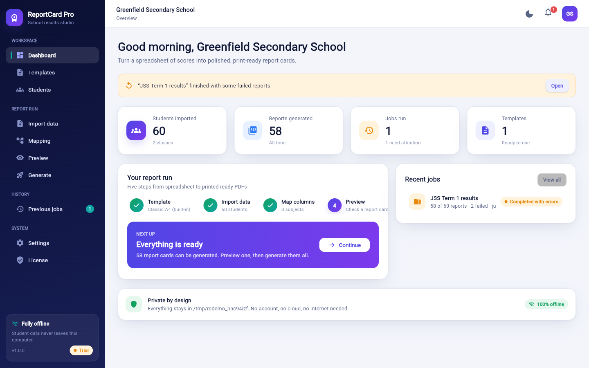
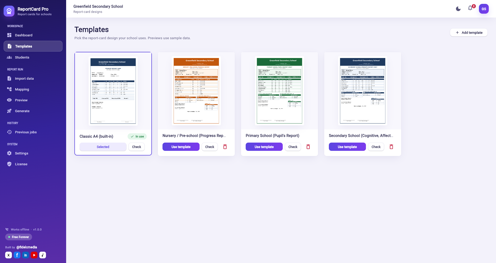
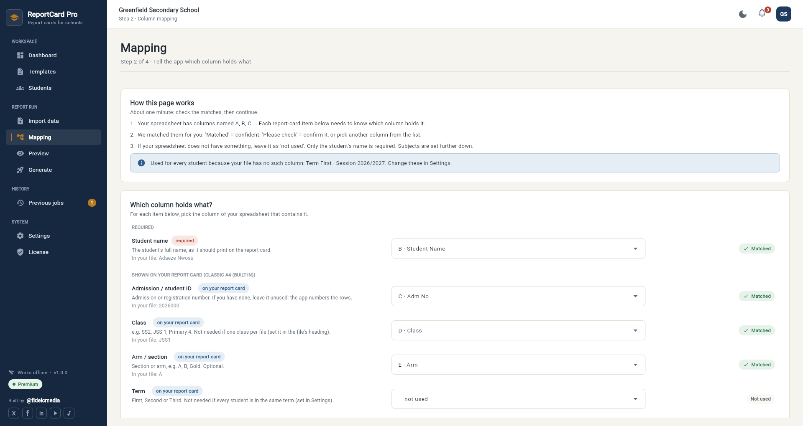
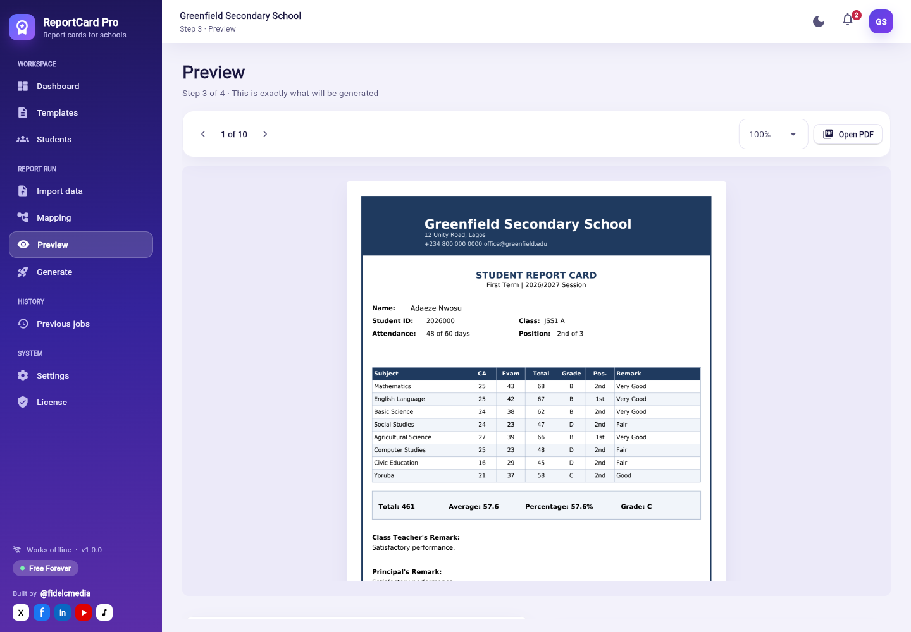
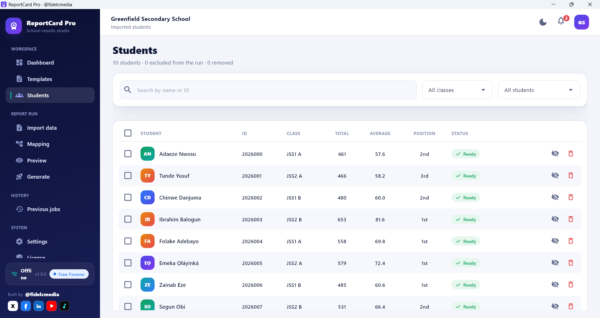
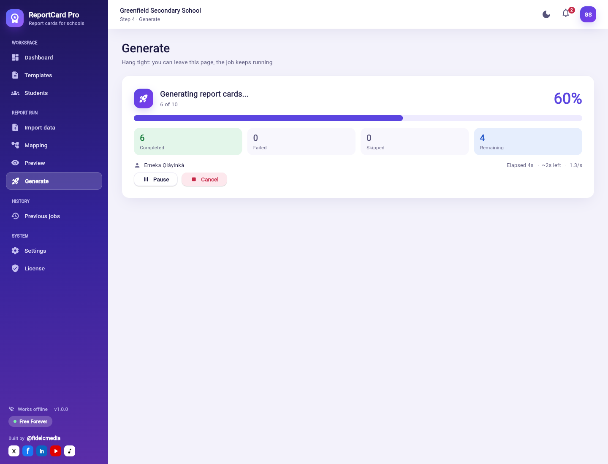
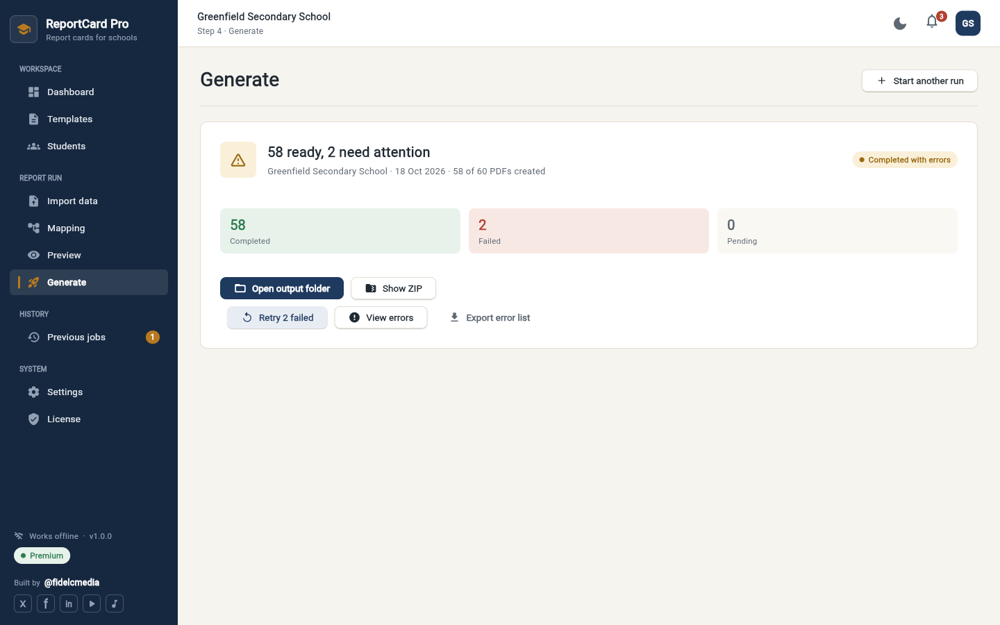
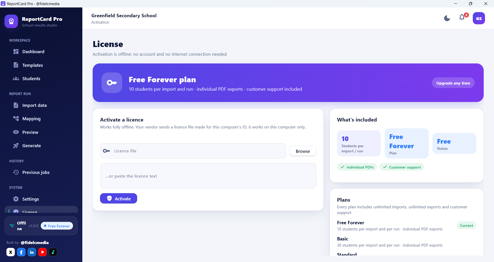
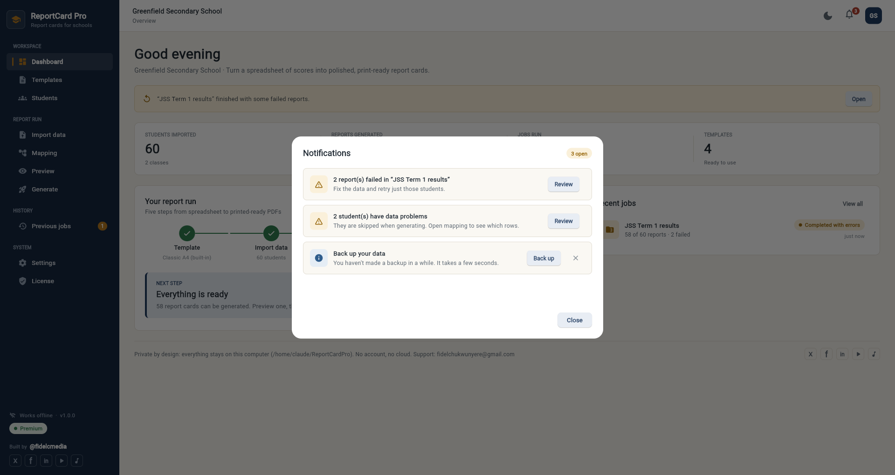

# ReportCard Pro: how it works

ReportCard Pro turns your class results spreadsheet into a finished report card for every student, as individual PDFs,
a ZIP file, or one combined PDF ready to print. It runs entirely on your computer: no account, no internet connection,
and your students' data never leaves the machine.

**Need help?** Customer support is included with every plan: email **fidelchukwunyere@gmail.com**, or message Fidelis Chukwunyere
(@Fidelcmedia) on X, TikTok, Facebook, LinkedIn or YouTube.

---

## 1. The short version

1. **Templates**: pick the report-card design your school uses.
2. **Import data**: choose your Excel or CSV file.
3. **Mapping**: check that the app matched your columns correctly.
4. **Preview**: look at a real report card before making them all.
5. **Generate**: choose what to create and where to save it, then press **Start generating**.

New here? On the **Dashboard**, press **Try with sample data** to go through the whole process with made-up students first.

---

## 2. The four plans

ReportCard Pro works straight after installing: the **Free Forever** plan needs no licence, never expires and has no hidden pages. Paid plans
raise the number of students and add export formats. Activating a licence just unlocks the app you already have.

| | Free Forever | Basic | Standard | Premium |
|---|---|---|---|---|
| Students per spreadsheet **import** | 10 | 30 | 100 | Unlimited* |
| Students per report-generation **run** | 10 | 30 | 100 | Unlimited* |
| Number of imports | Unlimited | Unlimited | Unlimited | Unlimited |
| Number of exports | Unlimited | Unlimited | Unlimited | Unlimited |
| Individual PDFs (one per student) | Yes | Yes | Yes | Yes |
| Combined PDF (all students, print-ready) | No | No | Yes | Yes |
| ZIP archive | No | No | Yes | Yes |
| Nursery, Primary and Secondary designs | Yes | Yes | Yes | Yes |
| **Customer support** | Yes | Yes | Yes | Yes |

\* Premium has no limit set by the app. What your computer can process depends on its processor, memory and free disk space; very large
runs simply take longer. Close other heavy programs and keep plenty of free disk space.

**How the student limit works.** The same number applies to a spreadsheet import and to a run. If your spreadsheet has more students than
your plan allows, the import is refused *before anything is changed*, with a message saying how many your plan allows: split the file
into smaller ones (you can import as many files as you like) or upgrade. In a run, the first students who are **ready** (no problems with
their data), in spreadsheet order, are created. On the Students page you can **Exclude** students to choose which ones. The Generate page
tells you exactly how many will be made, and the finished job shows how many were not generated.

### Choosing a design for your school level
On the **Templates** page you will find **Nursery / Pre-school**, **Primary School**, **Secondary School** and **Classic A4** designs.
They follow the layout of real Nigerian report cards: header with logo, motto and passport photo, personal details, attendance, performance summary,
subject results with class average, behaviour (affective) and skills (psychomotor) ratings, grading key, teacher and head-teacher remarks,
promotion status and next-term date. Optional spreadsheet columns that fill these in: `Gender`, `Date of Birth`, `Next Term Begins`, `Status`,
`Teacher Remark`, `Principal Remark`, and rating columns such as `Punctuality`, `Neatness`, `Honesty`, `Handwriting`, `Sports and Games` (ratings 1 to 5).
Sections without data are left out of the report card.

### Why upgrade

* **Your whole class (or school) in one run.**
* **The combined PDF and ZIP**: every report card in a single file, ready to send to the printer or share.
* **Nothing to reinstall or re-enter.** Your templates, settings, imports and history stay exactly as they are.
* **Fully offline activation.** No account, no sign-in, no internet connection: you receive a small licence file and activate it.
* **Renewals and changes are just a new file**: no new installer.

**A licence is tied to one computer.** For security, every licence file works only on the computer it was issued for, and the app
refuses it anywhere else. To get a licence, open the **License** page, press **Copy** under *This computer's ID*, and send it to your
vendor (see section 5). To move to a new computer, see *Moving your licence to another computer* in section 5.

---

## 3. Step by step

### Templates

The built-in designs are **Nursery / Pre-school**, **Primary School**, **Secondary School** and **Classic A4**. Press **Use template** to choose one, **Check** to see whether a template has problems,
or **Add template** to add your school's own design (a template `.json` file; fonts, logos and background images it uses are
copied into the app so it keeps working offline). Previews on this page use sample data.

### Import data
Choose an Excel (`.xlsx`, `.xls`) or CSV file. Use your own column names: the app works them out. Recent imports are listed so you can
re-open one without choosing the file again.

**Not sure how the spreadsheet should look?** On the Import page, pick your **school level** (Nursery / Pre-school, Primary, Secondary or
Any school), look at the preview of the columns, and press **Download example (.xlsx)**. The file is saved in your *Documents* folder
under *ReportCard Pro examples*. Replace the five pretend students with yours, then import it: every column in the example is recognised
automatically. The example has a second sheet, *How to fill this in*, that explains each column. The page also pre-selects the level that
matches the template you chose.

**What the spreadsheet needs**

* **One row per student**, with the column headings in one row (row 1 is best).
* **Only the student's name is required.** Everything else is optional, and you can delete columns you do not need.
* **Scores as plain numbers**, one column per subject (`Mathematics`), or two columns when you record CA and exam separately
  (`Mathematics CA` and `Mathematics Exam`). Leave a cell empty when there is no score.
* **Do not add** Total, Average, Grade or Position: the app works them out. If they are there they are ignored, never mistaken for subjects.
* **Behaviour and skills ratings** (1 to 5) in columns named like `Punctuality`, `Neatness`, `Honesty`, `Handwriting`, `Sports and Games`
  are printed by templates that have behaviour and skills tables.
* **Titles and notes are fine.** A title above the headings, a line such as `Nigeria | Class: SS2 | Term: First Term | Academic Session: 2026/2027`,
  and notes or a grading key underneath the students are all understood. The app finds the headings row itself, skips the notes, and reads
  the **class, term and session** from that line, so you do not need columns for them. After importing it tells you exactly what it did
  ("Row 5 was used as the column headings", "Ignored 2 note rows below the students").
* **Column letters.** Everywhere in the app columns are shown the way Excel shows them: `B · Student Name`. A column with no heading in
  your file appears as `C (no heading)`.

### Mapping

**What this page is for.** The report card has items (the student's name, class, days present ...) and your spreadsheet has columns
(A, B, C ...). Mapping simply tells the app which column holds which item. It takes about a minute, and the app remembers your choices for
spreadsheets with the same columns.

**How to read it**

1. Items are in three groups: **Required** (the student's name), **Shown on your report card** (the items your chosen template prints) and
   **Optional extras**. Under each item you see a one-line explanation and an example taken from your file.
2. The list on the right is that item's column. Choose another column from it at any time, or **not used** if your spreadsheet does not
   have the item.
3. The badge tells you what the app thinks: **Matched** means it is confident. **Please check** means it is unsure: look at the example,
   then press **Confirm** or pick the right column. You can only continue once the items that matter (required items and the ones printed
   on your template) are matched or confirmed. An unsure guess for an optional extra never blocks you and is simply left unused.
4. **Class, term and session** found in your file's heading are used for every student when there is no column for them. Change them in
   Settings.
5. Further down, **Subjects** lists each subject with its column(s). Rename, remove, or add one if something is missing. **Behaviour and
   skills ratings found** shows the rating columns the app detected. **Data check** lists problems (with the row number as Excel shows it),
   and students with a problem are skipped while the rest are generated.

The app never guesses silently, and it never treats Total, Average, Grade or Position columns as student details.

### Preview

Shows the real report card for a student exactly as it will be generated. Check a few students, including one with unusual
data, before generating everyone. You can exclude or remove students from here too.

### Students

Lists everyone in the current import. Two different actions:

* **Exclude from run**: the student is left out of the next run but **stays in the class ranking**, so other students'
  positions do not change. Use **Include** to undo.
* **Remove from data**: the student is taken out of the ranking altogether and **positions are recalculated**. You are asked
  to confirm; it is recorded in the activity log and can be undone with **Restore**.

Both work on one student or a selection.

### Generate

| Option | What it does |
|---|---|
| **Individual PDFs** | One PDF per student. On by default. |
| **ZIP archive** | All the PDFs in one ready-to-send file. Standard and Premium plans. |
| **One combined PDF** | Every report card in a single file for printing (split into parts of 1,000 for very large runs). Off by default. Standard and Premium plans. |
| **Job name** | A label for this run in Previous jobs. |
| **Save to** | The folder the files are written to. |
| **Filename template** | How each PDF is named. Click a field to add it: `{year}` `{student_name}` `{student_id}` `{class}` `{arm}` `{term}` `{session}`. An example name is shown as you type. Duplicate names get `_2`, `_3`; illegal characters are removed automatically. |
| **Order** | File order, Name A-Z, Student ID, Class then name, or Best first. |
| **Performance** | Automatic, or 1 / 2 / 4 / 8 workers. Leave on Automatic unless the computer struggles. |

Generation is safe to interrupt. Progress is saved, you can leave the page while it runs, and an interrupted job can be resumed.

### Previous jobs
Every run is saved. From here you can **Pause**, **Resume** an interrupted job, see **Errors** and retry only the failed
reports, or **Open folder** to find the files.

---

## 4. Settings

Changes apply immediately to previews and new runs.

**School**: name, motto, address, phone, email (printed on every report card), plus the default **session** (e.g. 2026/2027)
and default **term** (e.g. First).

**Grading**: the grading scale. Each band has a minimum, a maximum, a grade, a label and an optional remark. Bands must not
overlap. It is applied to every subject and to the overall result.

**Ranking & policy**
| Option | Meaning |
|---|---|
| Method | *Competition* (1st, 1st, 3rd), *Dense* (1st, 1st, 2nd) or *Ordinal* (no ties) |
| Rank within | Class and arm, whole class, or whole school |
| Minimum total to be ranked | Students below this total are not ranked. Blank means everyone is ranked. |
| Missing scores | *Leave unranked* or *Rank last* for students with missing scores |
| Highest score ranks first | Switch off to rank the lowest first |
| Maximum score per subject | The score a subject is out of |
| When a score is missing | *Fail that student* (safest: the student is skipped and reported), *Count as zero*, or *Skip that subject* |
| Overall grade based on | Average or percentage |
| Decimal places | 0 to 3 |

**Remarks**: rules that write the teacher/principal remark automatically. The **first matching rule wins**. A rule has a
*When* condition such as `average >= 80` and the *Remark* text. You can use `average`, `percentage`, `total`, `position`
and `attendance_pct`.

**Formulas**: extra calculated fields you can use on the report card. Formulas can use each other; circular references
are rejected. You can also set a **Subject total formula**; leave it blank for the automatic one (CA + exam, or the single
score column).

**Data & backup**: shows where your data lives and your database version. **Create backup now** saves one file containing your
database, templates and licence. **Restore from backup** → **Prepare restore**, then close and reopen the app to finish. Use
the **Activity log** to see every exclusion, removal and restore (it cannot be edited). Back up before big changes and
before moving to a new computer.

**Updates**: see section 6.

**Appearance**: dark mode.

**About**: version, credits and links.

---

## 5. The License page: what each part means

Open **License** in the sidebar. The top banner shows your plan (for example **Standard plan**, **Free Forever plan** or **Licence expired**). Under *What's included* you will see:

| Item | Meaning |
|---|---|
| **School** | Who the licence was issued to. |
| **License ID** | A reference for this licence (shown as "ID ..."). Quote it when you contact your vendor. |
| **Expires** | The last day the licence works. It is valid **through** that date and stops the day after. Shows "never expires" if there is no end date. |
| **Students per import / run** | The most students allowed in **one spreadsheet import and in one run**. "Unlimited" means the app sets no limit. Over the limit, an import is refused with a message and a run covers the first students up to the limit. |
| **Features** | What you may create: **Individual PDFs**, **ZIP export**, **Combined PDF**. A feature your licence does not include is refused when you try to use it. |
| **Status** | **Active** (licensed), **Expired**, or **Free**. |
| **Customer support** | Included with every plan. |
| **This computer's ID** | A code like `XXXXX-XXXXX-XXXXX-XXXXX` made from your computer by a one-way hash (it is not your serial number). Your licence is issued for exactly this ID. |

### Your licence is tied to one computer (security)
Every licence is issued for **one specific computer** and is checked against that computer's ID every time the app starts.
This is strict and has no exceptions: a licence file copied to another computer is refused ("License is bound to a different
computer") and that computer runs on the Free Forever plan instead. A licence file that names no computer is never accepted.
This protects you and your vendor from a paid licence being passed around. Your school data is never affected.

### Getting and activating a licence
1. Open **License**, press **Copy** next to *This computer's ID*, and send it to your vendor along with your school name.
2. The vendor sends you a licence file (`.rclicense`) made for that ID.
3. Open **License**, choose the file (or paste its text), and press **Activate**. It works offline.

### Renewing
Your vendor sends a new file. Activate it the same way; it replaces the old one. You do not need to reinstall anything.
The app warns you in the 30 days before your licence expires.

### What happens when a licence expires
The app does not lock you out or delete anything. It goes back to the **Free Forever** plan (10 students per import and run, individual PDFs)
and shows "License expired on ...". Your data, templates, imports and history are untouched and your saved class lists stay available; only **new**
imports and runs use the Free Forever limits. Activate a renewed licence to continue with your plan.

### Moving your licence to another computer
Because a licence is tied to one computer, moving takes four steps (about five minutes, no reinstalling of your data):
1. **On the old computer** (if you still have it): **Settings → Data & backup → Create backup now**, and copy the backup file. Then open **License**
   and press **Deactivate on this computer**.
2. **On the new computer:** install ReportCard Pro, open **License**, press **Copy** under *This computer's ID*, and send that ID to your vendor
   (fidelchukwunyere@gmail.com), saying it replaces the licence of your old computer and quoting your **License ID** (shown on the License page).
3. **Your vendor sends a new licence file** made for the new computer's ID. Choose it on the License page and press **Activate**.
4. **Bring your data across:** in **Settings → Data & backup**, choose **Restore from backup** → **Prepare restore** for the backup you made in step 1, then close and reopen the app.

Notes: restoring a backup on the new computer does **not** carry the old licence across (it is refused there, which is expected): you need the new
file from step 3. The computer ID can also change after a full Windows reinstall, a new motherboard or a new disk; the steps are the same. If the old
computer is lost, skip step 1's deactivation and just request the new licence. Your vendor decides whether a move is included in your plan, so ask before
you switch. Free Forever needs no licence and works on any computer.

### Messages you may see
| Message | What it means / what to do |
|---|---|
| License expired on *date* | Ask your vendor for a renewal. |
| License is bound to a different computer | This licence was issued for another computer and cannot be used here. Send your vendor this computer's ID (see *Moving your licence to another computer*). |
| License is not tied to a computer | The file is not a valid licence for this app. Ask your vendor for a licence made for this computer's ID. |
| License signature is invalid | The file was changed, damaged or is not from your vendor. Use the original file again. |
| License file is malformed | The file or pasted text is incomplete. Use the original `.rclicense` file. |
| License is for a different product | Not a ReportCard Pro licence. |
| License has an invalid expiry date | The licence was issued with an error. Ask your vendor to reissue it. |
| Your *plan* plan allows *N* students per run; *M* requested / per spreadsheet import | The run or file is bigger than your plan's limit. Exclude some students, split the spreadsheet, or ask your vendor for a larger plan. |
| Your *plan* plan does not include the '*feature*' feature | Switch that output off, or upgrade to a plan that includes it. |

---

## 6. Updates

The app never goes online by itself, so updates arrive as files. You can either:

* **Run the new installer over the old one.** Your data, settings and licence are kept; or
* Open **Settings → Updates**, choose the `.update.json` file that came with the new installer, and follow the prompts. The app
  checks that the update is signed by the vendor, is for your platform, is newer than your version, and that the file is intact.

When a new version starts for the first time it saves a safety copy of your data and then upgrades it automatically. A
newer version's data cannot be opened by an older version, so keep a backup and install updates rather than going back.

---

## 7. Your data and privacy

* Everything is stored in a folder on your computer (Settings → Data & backup shows where and has an **Open folder** button).
* The app does not connect to the internet by itself. Links in **About** only open in your own browser when you click them.
* Uninstalling keeps your data unless you choose to delete it.
* Back up regularly; the app reminds you when it has been a while.

---

## 8. Troubleshooting

| Problem | What to try |
|---|---|
| Only 10 (or 30, 100) report cards were made, or an import was refused | That is your plan's student limit (see section 2). Exclude students to choose who, split the spreadsheet, or upgrade on the **License** page. |
| ZIP / combined PDF is greyed out | Those exports are in the Standard and Premium plans. |
| A very large run paused with "the disk is full" | Free some space, then press **Resume**. Report cards already created are kept. |
| "Finish setup first" on Generate | Choose a template, import your data and confirm the mapping first. |
| A student was skipped | On **Previous jobs** open **Errors**. Usually a missing name or score (see *When a score is missing* in Settings). Fix the spreadsheet and import again, or change the policy. |
| A column wasn't recognised | On **Mapping**, choose the right column manually. |
| Positions look different from expected | Check **Settings → Ranking & policy** and remember *Exclude* keeps a student in the ranking but *Remove* does not. |
| Unknown field in the filename | Use only the fields shown as chips on the Generate page. |
| The licence stopped working | See the messages table in section 5. |
| Need help, a licence or a renewal | Contact your vendor, fidelcmedia (@fidelcmedia), using the links on **Settings → About** or the **License** page. |
